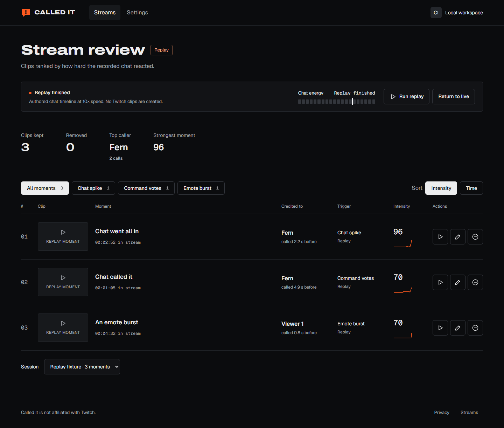

# Called It

**Chat becomes the stream’s collective clipper.** A local Twitch companion that catches collective reactions, creates a clip, and credits the first viewer who called it.

Built solo for the Codex x TwitchCon Hackathon in one Codex chat. Target channel: **hassan_an4s**. Channel points are deferred. The entrant supplies this chat’s actual session ID at submission.

## Problem and sources

Twitch introduced Stream Recaps on October 20, 2026 to help followers catch up through clips, then announced Recaps Spotlight clip promotion on October 27. Called It addresses a product hypothesis: small channels can have engaged chat without a dedicated clipper. It lets that community share the job. No audience growth, conversion or usage figures are claimed.

Sources:
- https://blog.twitch.tv/en/2026/10/20/stream-recaps/
- https://blog.twitch.tv/en/2026/10/27/investing-in-streamer-growth-through-clip-promotion/
- https://blog.twitch.tv/en/

## Features

- EventSub chat and stream status, connection recovery, duplicate handling, shared chat origin filtering.
- Configurable rate spikes, shared emote bursts and distinct command votes.
- Helix clip creation with offline errors, rate limit blocking and confirmation polling.
- Transparent OBS overlay with first caller credit, energy, cooldown and optional top callers.
- Persistent stream review, trigger filters, intensity/time sorting, details, local renaming and reversible removal.
- Clearly labeled replay using the same detector without Twitch credentials or real clip creation.
- Privacy page, favicon, self hosted licensed fonts and the supplied visual design.

## Quick start: replay

Requires Node.js 24 or newer and npm. No Twitch credentials needed.

~~~sh
npm ci
npm test
npm run build
npm start
~~~

Open **http://localhost:4317**, select **Run replay**, and allow about 28 seconds. The authored timestamped fixture contains a quiet baseline, command votes, a rate spike and a shared emote burst. The replay runs at 10 times recorded time; detection uses original timestamps. Default settings produce three moments. Fictional viewers and replay results are labeled test data, never real Twitch clips.

Changing settings changes replay results. Restore defaults for the reference demo. Stop replay ends the fixture; restarting creates a separate session. Return to live switches the overlay back. Live ingestion can continue while replay is viewed; replay never enters the live clip pipeline.

## Twitch setup

1. Register a confidential application at https://dev.twitch.tv/console/apps.
2. Add this exact OAuth redirect URI: **http://localhost:4317/auth/callback**.
3. Copy .env.example to .env in the repository root. Enter the Client ID and Client Secret there. Never put secrets in chat, source code, screenshots or Git.
4. Generate a separate 32 byte encryption key with the command below and put its output in TOKEN_ENCRYPTION_KEY.
5. Set TWITCH_CHANNEL=hassan_an4s for this entry, or your own channel login for another installation.
6. Restart the app, open Settings, choose Connect Twitch and authorize as the broadcaster.
7. Enable clips in Twitch settings and go live. Called It checks live status at connection and before creating a clip.

~~~sh
node -e "console.log(require('node:crypto').randomBytes(32).toString('base64'))"
~~~

Use localhost for the dashboard and redirect. The server binds only to loopback. This MVP serves one streamer on one computer.

| Environment variable | Purpose |
| --- | --- |
| PORT | Local port; default 4317. |
| BASE_URL | Must equal http://localhost:PORT; default http://localhost:4317. Update Twitch’s redirect if changing it. |
| TWITCH_CHANNEL | Optional expected broadcaster login; example uses hassan_an4s. |
| TWITCH_CLIENT_ID | Twitch application ID, live mode only. |
| TWITCH_CLIENT_SECRET | Confidential application secret, live mode only. |
| TOKEN_ENCRYPTION_KEY | Base64 encoding of 32 random bytes, live mode only. |

Tokens are encrypted with AES 256 GCM in data/tokens.enc. Settings and session metadata are in data/state.json. The encryption key stays in the environment. Losing the key requires removing the old token file and reconnecting. The .env file, data directory, caches and browser state are gitignored. Encryption does not protect against someone controlling the computer and reading both the token file and key; use operating system account protection.

## OBS browser source

1. Start Called It and open Settings.
2. Copy Browser source link, including its private read only key in the URL fragment.
3. Add a Browser Source in OBS and paste the link. Set width **1920**, height **1080**.
4. Place it above your stream content. Background transparency is built in.
5. Choose notification corner, energy visibility and top callers in Settings.
6. Run replay to verify placement. Return to live before filming live proof.

Only a confirmed Twitch clip displays **Clip saved**. Replay displays **Replay moment** with a persistent replay label. Notifications last four seconds; reconnecting receives current state without repeating stale notifications. Reset link invalidates the old overlay key, so update OBS afterwards.

## Architecture

~~~mermaid
flowchart LR
  OAuth[Twitch OAuth] --> Vault[Encrypted local token vault]
  Twitch[Twitch EventSub WebSocket] --> Adapter[Chat and stream adapter]
  Fixture[Recorded fixture timestamps] --> Replay[Replay clock]
  Adapter --> Detector[Pure moment detector]
  Replay --> Detector
  Detector --> Coordinator[Session coordinator]
  Coordinator --> Helix[Helix Create Clip]
  Helix --> Confirm[Get Clips confirmation]
  Confirm --> Store[Local session store]
  Coordinator --> Store
  Store --> WS[Local WebSocket snapshots and events]
  WS --> Dashboard[Streamer dashboard]
  WS --> Overlay[Read only OBS overlay]
  Vault --> Helix
~~~

Node.js and TypeScript run HTTP, WebSocket, OAuth and Twitch integration. The frontend uses TypeScript, native DOM APIs and Vite. There is no remote database or analytics. The supplied design is preserved in design/Called It.html. Specification, plan and tasks are in specs/001-called-it/.

## Twitch APIs and subscriptions

| API or subscription | Purpose | Authorization |
| --- | --- | --- |
| OAuth authorize, token, validate, revoke | Connect, exchange, refresh, validate at startup and hourly, disconnect | Authorization code flow; secret stays on server |
| POST /helix/eventsub/subscriptions | Subscribe after WebSocket welcome | Socket’s user token |
| channel.chat.message v1 | Chat messages and Twitch emote fragments | user:read:chat; broadcaster is the reading user |
| stream.online v1, stream.offline v1 | Session lifecycle | No additional scope |
| GET /helix/streams | Initial live status and preclip check | User token |
| POST /helix/clips | Create a clip | clips:edit |
| GET /helix/clips | Confirm creation and retrieve metadata | User token |

The app uses a broadcaster user token over WebSocket, not an app token or separate bot account. Additional user:bot and channel:bot rules for app token chat subscriptions do not apply to this flow. No chat posting scope is requested. Channel point redemptions are not implemented.

Documentation:
- https://dev.twitch.tv/docs/eventsub/eventsub-subscription-types/#channelchatmessage
- https://dev.twitch.tv/docs/eventsub/handling-websocket-events/
- https://dev.twitch.tv/docs/api/reference/#create-clip
- https://dev.twitch.tv/docs/api/clips/
- https://dev.twitch.tv/docs/authentication/getting-tokens-oauth/#authorization-code-grant-flow
- https://dev.twitch.tv/docs/authentication/validate-tokens/
- https://dev.twitch.tv/docs/authentication/refresh-tokens/

A Twitch reconnect instruction opens the replacement socket before closing the old one and retains subscriptions. A lost connection uses bounded exponential backoff and recreates subscriptions. Keepalive timeouts trigger recovery; revoked permissions stop ingestion. EventSub does not replay chat lost during an outage.

HTTP 202 starts the clip process. Get Clips must confirm it before the overlay announces success. Polling is bounded by attempts and a 15 second confirmation window. Offline channels, restrictions and failures create failed moment records, not saved credits. Rate limit headers block requests until reset. Unauthorized requests retry once after a shared refresh; ambiguous network failures on clip POST are not blindly retried.

Rename and discard change **Called It’s local review records**, not Twitch’s clip title or video. Open on Twitch provides access to Twitch’s own management tools. Credit counts confirmed moments, even if later removed from the local selection.

## Detection algorithm

The detector has no network, random IDs or wall clock. Identical timestamped messages and settings produce identical decisions.

1. Keep a rolling history; deduplicate message IDs and ignore late timestamps. Equal timestamps preserve input order.
2. Compare a 10 second reaction window to the preceding 120 second baseline, excluding the reaction window itself. Automatic rate detection needs 30 seconds of baseline warmup.
3. Chat spike: at least 12 messages from 3 viewers, at 3 times baseline rate. A 0.1 message per second floor handles quiet channels.
4. Command votes: 8 distinct viewers within 20 seconds. Match the exact first whitespace delimited command token, case insensitively. Repeated votes from one viewer count once.
5. Emote burst: the same Twitch emote appears in messages from 5 distinct viewers and at least 60 percent of active messages. Repeated fragments in one message count once. Third party emote names received as plain text do not count.
6. Any enabled eligible signal triggers one moment; store all satisfied reasons. Credit the first command voter in the active vote window, otherwise the first message of the accelerated run for a spike, or the first contributing emote message. The accelerated run is the trailing cluster whose adjacent gaps are no greater than the baseline expected message interval divided by the spike ratio, with a 250 ms jitter allowance. This avoids crediting a quiet message from before the burst.
7. Start a 90 second cooldown at detection. Consume triggering activity. Messages during cooldown still contribute to the baseline, but new activity must qualify after cooldown.

Energy is 70 times the strongest normalized enabled signal, capped at 100. Minimum message counts, viewer counts and emote share gate progress to the trigger line. Intensity uses the strongest qualifying signal’s rate ratio, vote count or emote viewer count divided by its threshold, multiplied by 70 and capped at 100. This preserves stronger rate reactions once eligibility is satisfied. Equal scores sort by time. It measures chat reaction, not clip quality or projected views. Sparklines contain actual recorded energy samples.

Every threshold, window, signal toggle, baseline floor, command and cooldown is configurable and validated on the server. Changing settings affects subsequent decisions. Existing moments retain their recorded observations.

## Validation and development

~~~sh
npm test
npm run check
npm run build
npx --no-install playwright-cli -s=called-it open http://localhost:4317
npx --no-install playwright-cli -s=called-it resize 1440 1000
npx --no-install playwright-cli -s=called-it snapshot
~~~

Detector tests use persisted authored timelines. Twitch client tests inject a fake HTTP transport and cover encrypted storage, refresh concurrency, offline behavior, rate limits, ambiguous POST failure and confirmation. These tests do not prove a real Twitch clip. See docs/VALIDATION.md for verified results and remaining live acceptance work.

The app does not persist raw chat by default. A consented real timeline can use the fixture structure: id, at, userId, name, text and emotes. Use relative millisecond timestamps; pseudonymize IDs and names; remove private text and accurately describe provenance. Bundled fixtures are synthetic, not recordings from the entrant’s channel.

Run npm run build after frontend changes. npm run dev watches backend files and serves the most recent frontend build.

## Limits and next steps

Local, single streamer only. No recovery of missed chat during outages, automatic video trimming, guaranteed clip alignment, Twitch clip deletion, hosted tenancy or channel points. Tune thresholds with the community. Live OAuth and clipping require a registered application and a live channel; do not substitute replay for live proof.

## License

Application source: MIT, see LICENSE. Archivo, Geist and Geist Mono retain their SIL Open Font License notices in web/public/fonts/LICENSE.txt. The supplied design export retains its embedded notices. Called It is not affiliated with Twitch.
